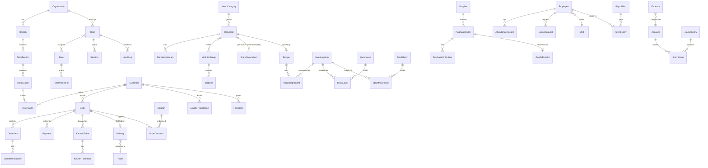

# ER Diagram (core entities)

Full schema in `prisma/schema.prisma`. Every tenant table additionally carries: `organizationId`, (`branchId`), `createdAt`, `updatedAt`, `deletedAt`, `createdById`, `updatedById`, `status`.

## Key design decisions

- **Orders are immutable after close** — corrections happen via refund/void records, preserving audit trail.
- **Stock ledger (`StockMovement`) is append-only**; `StockLevel` is a maintained aggregate (recomputable from ledger).
- **Finance is double-entry**: `JournalEntry` must balance (checked in service layer + DB trigger); P&L and balance sheet are queries over `JournalLine`.
- **Recipes decouple menu from inventory**: selling a MenuItem consumes inventory through its active Recipe version.
- **Branch overrides** (`BranchMenuItem`) let franchises vary price/availability without duplicating the catalog.
- **Partitioning candidates** (when volume demands): `orders`, `stock_movements`, `audit_logs` by month via `created_at`.
